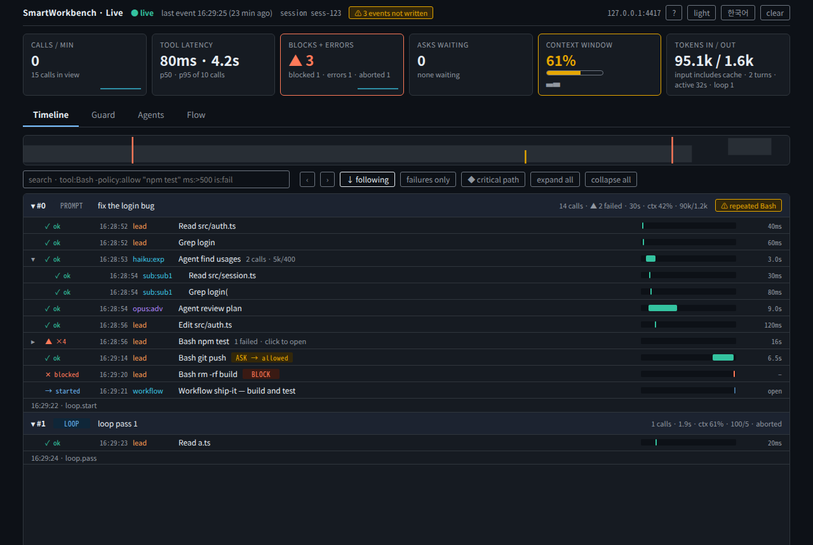

# SmartWorkbench for Claude Code

[English](#english) · [한국어](#한국어)

---

## English

A Claude Code mod for seeing and steering the **Intent, Context, Run and Evidence** of the work you hand to Claude, without leaving Claude Code.
Implements P0 (first public release), P1 (product hardening) and P2 (team features) of the product spec (v0.1), checked in a live terminal session.
Try it on the [sample project](examples/sample-project/README.md); review what it may do in [PERMISSIONS](docs/PERMISSIONS.md).

### Install

At the Claude Code prompt:

```
/plugin install smartworkbench --marketplace nathak/smart-workbench
```

Answer `y` to add the marketplace and choose the user scope.

Update an installed copy:

```bash
claude plugin marketplace update smart-workbench
claude plugin update smartworkbench
```

then restart Claude Code or run `/reload-plugins`.

### Quick start

1. **Start a task**: run `/swb new`. The panel opens on the Intent tab.
2. **Write the contract**: type the goal in the Goal field and press Enter. Add constraints (prefix `s:` for a soft one) and done conditions such as `Related tests pass` or `Typecheck passes`; each condition is linked to the matching kind of check from its wording.
3. **Lock it**: press `Lock` (hotkey `l`) or run `/swb lock`. From now on the contract rides along with every prompt as context only Claude reads.
4. **Pin context** (optional): in the Context tab, pin files (`src/auth.ts` or `src/auth.ts:10-40`) and notes. `Preview` shows exactly what Claude will receive.
5. **Work as usual**: ask Claude in the normal prompt. The Run tab lists each tool call; risky ones are asked or blocked by the guard.
6. **Check the result**: when the turn ends a completion summary is posted. Open the Evidence tab (`/swb verify`) to see which conditions passed, which files have a check behind them, and use `Verify`, `Waive`, `Ask Claude to finish` or `Export handoff`.
7. **Pick it up later**: state is restored when you reopen the project, and sessions open on the same project share it. On another machine, `/swb share` here and `/swb pickup` there. Save a setup you reuse with `/swb save <name>`.

To use the panel from the keyboard, focus it with `ctrl+x tab` (or click it). Hotkeys: `1`–`5` tabs, `l` Lock/Unlock, `p` Preview, `r` Pause risky calls, `f` Ask Claude to finish, `c` Check CI, `x` Export handoff.

### Commands

`/swb` is the short alias of `/smartworkbench`; `/workbench` is a deprecated alias kept for now. An unknown argument prints the command list.

| Command | Summary |
|---|---|
| `/swb` | Open the panel |
| `/swb new` | Start a new task contract |
| `/swb lock` · `/swb unlock` | Lock or unlock the contract |
| `/swb team [on\|off]` | Team mode: Opus designs and reviews, Sonnet builds, Haiku explores; opens the Team tab |
| `/swb live [port\|stop] [--no-prompts]` | Start or stop the live web view of the request flow |
| `/swb loop <count\|inf> <item>[; <item>...]` · `stop` · `status` | Repeat a task; see *Loop* |
| `/swb team <role> <model> [effort]` | Set a role's model and effort (`lead`, `explorer`, `advisor`) |
| `/swb advise [topic]` | Ask the Opus advisor now |
| `/swb intent` · `context` · `run` · `verify` | Open that tab |
| `/swb status` | Text summary |
| `/swb preview` | Show what is added to each prompt |
| `/swb save <name>` | Save the setup as a template |
| `/swb load <name>` | Start a task from a template |
| `/swb templates` | List templates and context sets |
| `/swb export [path]` | Write a Markdown handoff |
| `/swb policy [init\|reload]` | Show, create or re-read the project guard file |
| `/swb ci` | Import CI results for the current commit |
| `/swb issue <ref>` | Link the task to an issue |
| `/swb share [path]` · `/swb pickup [path]` | Hand the task to another machine through git |
| `/swb audit [n]` | Show the audit log |
| `/swb clear` | Reset this project's state |

#### `/swb`
Opens the SmartWorkbench panel on the last tab used. Where no panel can be shown, it prints the same text as `/swb status` instead.

#### `/swb new`
Starts a fresh task contract and opens the Intent tab; when the project guard file names a `defaultTemplate`, the new task starts from that team template. If a goal is already set it asks first (`Start new` / `Keep current`). Without a template goal, the goal is drafted from your last prompt in the session or, failing that, the branch name (`fix/PROJ-12-login-expiry` → `Login expiry`); edit it before locking. The previous goal, constraints, non-goals, done conditions, evidence and changed-file record are cleared and the contract is unlocked. Pins, tool call history and the guard profile are kept.

#### `/swb lock` · `/swb unlock`
Lock the contract (it is added to every prompt from then on) or unlock it to edit; the same as the Intent tab's `Lock` button, handy from the keyboard or a remote surface. Locking needs a goal.

#### `/swb team [on|off]` · `/swb advise [topic]`
See *Team mode* below. `/swb team` alone shows whether it is on and how many Opus reviews ran this session. `/swb advise` asks Claude to consult the Opus advisor about the topic (or the task as a whole) with a focused brief and report its verdict.

#### `/swb intent` · `/swb context` · `/swb run` · `/swb verify`
Open the panel on that tab. `/swb evidence` is the same as `/swb verify`.

#### `/swb status`
Prints a text summary: the band line, the goal with its lock and status, active constraints, pins, the project guard file if there is one, and every done condition with its result. Use it where no UI is drawn (VS Code chat, `claude -p`, remote surfaces) or to paste the state somewhere.

#### `/swb preview`
Prints exactly the context SmartWorkbench adds to each prompt: the locked contract (`<smartworkbench_contract>`) and the pinned files and notes (`<smartworkbench_pins>`), plus a warning for any pin that cannot be read. An unlocked contract is not added, so with nothing locked or pinned it says nothing is added. The Context tab's `Preview` button shows the same text.

#### `/swb save <name>`
Saves the current setup as a template: goal, constraints, non-goals, done conditions (wording and evidence link), pins and guard profile. Results (evidence, history, changed files) are not saved. Templates are shared by all your projects, and saving under an existing name replaces it.

#### `/swb load <name>`
Starts a task from a template and opens the Intent tab. If a goal is already set it asks first (`Load template` / `Keep current`). The task comes in unlocked with no evidence, and the template's pins and guard profile **replace** the current ones. Your own templates are looked up first, then the team templates in the guard file; `team:<name>` picks the team one. A team template sets the contract only and leaves pins and the guard profile alone. With an unknown name it lists the templates you have.

#### `/swb templates`
Lists your templates, the team templates from the guard file (marking the default) and context sets. Context sets are saved and added from the Context tab (`save pins as a context set`, `Add set`); adding a set merges its pins into the current ones and skips any already pinned.

#### `/swb export [path]`
Writes a Markdown handoff for the next session or developer, by default to `.claude/smartworkbench-handoff.md` (the Evidence tab's `Export handoff` does the same). It holds the status, goal, constraints and non-goals; each done condition with its result and the command or manual note behind it, flagged when code changed after it passed; pinned context; changed files with their regions and whether a check passed after the last edit; the last 10 verification runs; and blocked or declined calls. Exporting again overwrites the file. It lands inside the project, so add it to `.gitignore` or pass another path if it should not be committed.

#### `/swb policy [init|reload]`
- `/swb policy` (or `reload`): re-reads `.claude/smartworkbench.json` and prints its profile, rules and any errors.
- `/swb policy init`: writes an example file when none exists, then shows it. Edit and commit it to share the rules with the team (see *Project guard file*).

#### `/swb ci`
Asks the local `gh` CLI for the GitHub Actions runs of the current commit (`git rev-parse HEAD`) and records the latest run of each workflow as `ci` evidence: success counts as passed, failure/cancelled/timed out as failed, a running workflow as observed. While code changes are uncommitted, CI did not test what is on disk, so every result counts only as observed. Running the command again updates the same run's record. Link a done condition to `ci` (conditions mentioning CI are linked automatically). The Evidence tab's `Check CI` button (hotkey `c`) does the same. This is the only feature that reaches the network, and only when you run it.

#### `/swb issue <ref>`
Links the task to an issue; it becomes part of the contract (`<issue>`) and the handoff.
- `#42`, `42` or a GitHub issue URL: read with `gh issue view`; the title fills an empty goal and the description is pinned as a note.
- Anything else, such as `LIN-12 Fix login timeout`: kept as typed, for Linear, Jira or any tracker.
- `/swb issue clear` unlinks it. The issue changes only while the contract is unlocked.

#### `/swb share [path]` · `/swb pickup [path]`
State is kept per machine, so to continue on another computer:
1. `/swb share` writes the contract (with manual marks and the issue) and the pins to `.claude/smartworkbench-task.json`. Commit and push it.
2. On the other machine, pull and run `/swb pickup`. It asks before replacing a current task.
Evidence does not carry over: checks run on one machine say nothing about another's working tree, so run them again there. Several sessions on the same machine and project need neither command: each save builds on the newest copy, and a change saved by another session is picked up before the next prompt.

#### `/swb audit [n]`
Shows the last `n` (default 20) entries of the audit log, when the guard file turns it on (see *Audit log*).

#### `/swb clear`
After asking (`Clear` / `Cancel`), resets this project's workbench: contract, pins, observed files, tool call history, evidence and changed files. The guard profile and pause switch, templates, context sets and other projects are left alone.

#### `/swb live [port|stop] [--no-prompts]`
Starts the live web view as a child process of the session and prints its address (default `http://127.0.0.1:4317`; the port must be 1024 to 65535). `stop` ends it. Running it again while a view is up prints the address; with `--no-prompts` it switches the running view to short prompts from then on (stop and start again to get full prompts back). A view that its process note shows still running on this machine is not started over (the message says which process holds it and which two files to delete if it is gone). `--no-prompts` keeps only the first 120 characters of each prompt and no subagent results. See *Live view*.

#### `/swb loop <count|inf> <item>[; <item>...]` · `stop` · `status`
Repeats a task; `stop` ends it after the current turn and `status` shows the passes done. See *Loop*.

#### `/swb team codex ...`
Switches for the optional Codex second opinion: `on`, `off`, `check`, `review on|off`, `rescue on|off`. See *Team mode*.

### Panel

- **Intent**: goal, constraints (`[H]`/`[S]`, on/off, prefix `s:` to add a soft one), done conditions and non-goals. **Lock** adds the contract to every prompt as model-only context (`<smartworkbench_contract>`); the message you typed is left as is. A locked contract cannot be edited.
  - **Proposals**: Claude cannot change the contract, but it can call the `propose_contract_change` tool (the contract tells it so). Each proposal appears at the top of the Intent tab with its reason and `Approve` / `Reject`; approving applies it even to a locked contract.
- **Context**: pin files and notes. Pin a line range with `path:10-40` (or `path#L10-L40`). Each file pin switches between `Live` (re-read at send time) and `Snap` (keeps the text and SHA-256 as pinned, up to 64 KB). Save the current pins as a named context set and add it to any project with `Add set`.
  - Files Claude reads or edits are classified as source, test, config, docs, generated or secret. Source, test and config files that were edited or read at least twice show up under **SUGGESTED**: `Pin` accepts one, `Hide` dismisses it. Secret and generated files are never suggested. The rest are listed under OBSERVED.
  - Token sizes are estimates marked with `~`. **Preview** is built by the same function that builds the injected text. A pin that cannot be read warns but never blocks the prompt.
- **Run**: every tool call is recorded with a risk level. Guard profiles (Permissive / Balanced / Strict) and `Pause risky calls`.
- **Evidence**: results of test, build, typecheck and lint commands are collected and linked to done conditions (guessed from the wording, changeable). `Verify` and `Waive` are manual marks that keep a note and a time. Each turn ends with a completion summary, and `Export handoff` writes Markdown for the next session or developer.
  - At the end of each turn `git diff -U0 HEAD` gives the changed regions per file (`L10-24, L41 (del)`), and each file shows whether a check passed **after** its last edit (✓ passed · ✕ failed · ! no check · · docs).
  - If code changes after a passing test, that condition drops to `observed` (re-run needed) and no longer counts as done. Edits to docs and generated files are exempt.
- **Tool row badges**: Claude Code's own tool rows stay as they are; one line is added only when there is a risk, a policy outcome (Blocked/Declined/Asked) or a check result (`test passed · evidence for dc-1`).
- **Failed tool rows** get `Explain` and `Retry` (each sends Claude a prompt) and, for shell commands, `Add evidence` to count a run SmartWorkbench did not recognize (`./scripts/check.sh`) as a test, build, typecheck or lint result.
- **Turn result**: when a turn ends with conditions unmet, the band shows `Turn ended INCOMPLETE · 0/1 done · 1 failing` with `Fix failures` (or `Ask Claude to finish`), `Waive`, `Open evidence` and `×`; it clears on the next prompt.

Band above the prompt: `WB ● Goal │ Ctx +2 pins · 42% │ Done 1/2 │ Guard BALANCED [Open]`

### Team mode

**Opus designs. Sonnet builds. Haiku explores. Opus reviews.** Opus's context is spent only on the decisions that need it.

- At session start SmartWorkbench registers two read-only agents:
  - `smartworkbench:explorer` (Haiku): finds files, reads code and searches docs; Claude can launch several at once.
  - `smartworkbench:advisor` (Opus): reviews from a focused brief Claude writes (goal, plan or error, what was tried, paths) and answers `VERDICT / BLOCKERS / RISKS / MISSING`. It never sees the whole conversation and never edits.
- `/swb team on` switches the session model to Sonnet (the same setting `/model` changes; `/swb team off` puts the previous model back) and adds a short role brief to every prompt. Opus then steps in by itself:
  - **Design first**: before a big edit (more than 6 lines or 400 characters, a second file, a bulk replace, or more than 15 lines of small edits in a turn) the edit is sent back once until the advisor has produced a `DESIGN` (`APPROACH / FILES / STEPS / RISKS / DONE`) in this turn. Small edits and files outside the project pass. A loop pass and the turn after an approved plan keep the design they already have; every other turn asks again. It is asked once per turn, so a lead that ignores it is not stuck, and the audit log records `team.design-required`.
  - **Plan from the design**: `ExitPlanMode` is sent back until the advisor has worked on the plan in this turn; the plan presented is its design.
  - **Repeated error**: when the same command fails twice in a row, its result tells Claude to consult the advisor with the error output and what it tried (once per command until it does).
  - **Final check**: a turn that changed code is held once at the end until the advisor has looked at it; if Claude finishes anyway, the next stop goes through.
- `/swb advise [topic]` asks the advisor any time. The Run tab shows team mode and the number of Opus reviews; the band shows `Team`; the audit log records `team.*` events.
- Haiku here is Haiku 4.5, the current Haiku model.

**Codex (OpenAI), optional.** If the Codex plugin (`/plugin install codex@openai-codex`) is installed, team mode can use it as a second opinion. It is off by default, because Codex sends the diff and the files it reads to OpenAI under your Codex account (billed there, secrets are not filtered out by SmartWorkbench).

- `/swb team codex on` asks for your consent, then turns on cross-review; `/swb team codex review on|off`, `/swb team codex rescue on|off`, `/swb team codex off`, `/swb team codex check` (runs the plugin's own `setup --json`; the only time login is checked). The Team tab has the same switches.
- Cross-review: when a turn changed code, the lead runs one read-only `codex-companion review --wait` before the advisor's final check, and gives the findings to the advisor, which decides what to fix. One review per turn; none during `/swb loop` passes. Rescue: after a repeated error the lead may ask Codex one read-only `task`. Codex output is treated as data to verify, not instructions, and the Stop check never requires it, so a Codex failure cannot trap the turn.
- The Guard asks before any Codex review or task unless you turned the matching switch on; `--write` tasks and `transfer` (sends the session transcript) are asked every time in the forms the Guard recognises, even under `permissive` or a project rule that loosens them, and have no "Allow for session". The unasked review and rescue apply only to a plain `node <plugin script> <op> [--wait|--background] ["text"]` command; anything chained or redirected goes to the Guard. Rescue is one task per turn. Codex's own edits do not pass the guard, so SmartWorkbench offers no general write setting.
- Image generation needs no switch: with Codex on, a plain `task --write "<what to draw>; save it as assets/<name>.png ..."` runs without asking when the brief names an image and one output file under `assets/`, `images/`, `public/` or `static/`. Codex's imagegen tool makes the picture; its path is only as binding as the brief, since Codex's own writes do not pass the guard. Any other `--write` still asks. After an image run SmartWorkbench compares `git status` before and after and warns (toast, flag in the live view, audit line) when a file outside those picture paths changed; the comparison covers each changed path's size and modification time, so a further edit to a file that was already modified is seen too. It never reverts anything and skips background runs.
- The live view shows a Codex box and link; The counts are runs of the command, not passes. Background jobs are shown as "state not tracked here".

**Team tab** (hotkey `5`, or `/swb team`): turn team mode on or off and pick each role's model and effort from drop-downs. Remote or keyboard: `/swb team advisor opus max`, `/swb team explorer sonnet low`, `/swb team lead opus[1m] high`. Each choice is an alias and the list shows the version it usually stands for (`opus (claude-opus-5-5)`); Claude Code decides what an alias resolves to, so the hint can lag behind a newer model.

| Role | Default | What a change does |
|---|---|---|
| Lead (the session) | `sonnet`, effort `default` | model: the session's model setting (choices as `/model` offers them), applied while team mode is on and restored when it goes off; effort: runs `/effort`, which Claude Code keeps as your default for that model, so it is left alone until you pick a level |
| Explorer | `haiku`, `low` | the agent is registered again; used from the next delegation |
| Advisor | `opus`, `high` | the same; a model that refuses an effort setting runs at its default and you are told |

Choices are kept per project. The tab also shows the session's current model setting and how many advisor reviews ran.

### Loop

`/swb loop <count|inf> <item>[; <item>...]` repeats a task. It works with or without team mode.

- `/swb loop 5 fix the lint errors; run the tests` runs five passes; `inf` (or `forever`, `무한`) runs until stopped. A count is 1 to 1000. Items split on `;` and are all done, in order, on every pass.
- A pass counts when the turn really ends: the loop uses the same Stop hold as team mode's final check, so with team mode on a pass that changed code goes through the Opus final check first, then the next pass starts.
- `/swb loop status` shows the passes done; `/swb loop stop` ends it after the current turn. A prompt you type yourself also ends it, so you always take the session back.
- To stop an `inf` loop: `/swb loop stop`, or press Esc and type any prompt. An `inf` loop also ends by itself after 3 passes in a row that change no file: no Edit, Write, MultiEdit or NotebookEdit edit and, in a git repository, no change to the working tree (so edits made by shell commands count there; outside git they do not). The tree is compared by hash (git's changed paths plus each one's size and modification time, read with `git status` and one small read-only node call) at the start of an `inf` loop and at the end of each of its passes. A file touched without a change in size counts too, since its modification time moves. Build output that is not git-ignored and changes every pass keeps an `inf` loop alive until you stop it. Each pass costs a full turn (and, with team mode, an Opus final check when code changed), so prefer a count unless you are watching.
- Loop state lives in the session only; a restart never resumes one. The audit log records `loop.start`, `loop.pass`, `loop.done`, `loop.stop` and `loop.cancel`.

### Built-in guard rules (Balanced)

| Category | Examples | Policy |
|---|---|---|
| Read | Read, Grep, search | Allow |
| Workspace edit | Edit, Write | Allow (Ask under Strict) |
| External send | `git push`, `gh pr create`, `npm publish`, `curl -X POST`, `docker push`, `terraform apply`, deploys | Ask |
| Possible secrets | `printenv`, `cat .env`, `$..._TOKEN`, editing `.env` | Ask |
| Destructive git | `push --force`, `reset --hard`, `clean -f`, `branch -D`, `restore .`, `checkout .`, `stash clear` | Block |
| Broad delete | `rm -r`, `find -delete` | Block |
| Disk overwrite | `dd of=/dev/sda`, `mkfs …` (any target; `--help` is fine) | Block |
| Remote script | `curl … \| sh`, `bash <(curl …)` | Ask (even under Permissive) |
| MCP deploy/release | `mcp__vercel__deploy_project` | Ask (even under Permissive) |
| MCP issue/alert changes | `mcp__linear__create_issue`, `mcp__pagerduty__acknowledge_incident` | Ask |
| MCP issue/observability reads | `mcp__linear__list_issues`, `mcp__sentry__search_events` | Allow |

- Ask uses Claude Code's own question dialog (`$.ui.ask`) with **Allow**, **Allow for session** and **Block**; an allowed call still goes through Claude Code's own permission check.
- **Allow for session** stops asking for the same thing until the session ends: a shell command by its command and subcommand (`git push`, `npm publish`, `gh pr create`), a file edit by its path, an MCP tool by its name. A chain counts only as the same set of commands, so `git push && curl -X POST …` is asked again after allowing `git push`. It never lifts a Block, is not offered for editing the guard file or for a script piped from the network, and is ignored while `Pause risky calls` is on. The Run tab lists these under ALLOWED FOR THIS SESSION, each with `×` to revoke; such calls show `SESSION` there.
- Block does not run the tool and tells Claude why.
- If the guard itself fails, only high-risk calls are refused (fail closed); everything else falls back to the normal flow.
- `git -C dir push -f`, `/bin/rm -rf`, `rm -f -r` and `git push -fu` are read like their plain forms. Quoted text that is data (a commit message after `-m`, the pattern of `grep`/`rg`) is not read as a command; every other quote, such as `bash -c "..."`, still is.
- This is a regex-based workflow control, not a security sandbox.

### Live view

Watch a request flow in a browser: prompts, tool calls and guard decisions, subagents, holds, loop passes and turns.

- `/swb live [port]` starts the server as a child of the session and prints its address (default `http://127.0.0.1:4317`); open it in a browser. `/swb live stop` ends it, and it also ends with the session. To run it yourself: `node <plugin folder>/tools/live.mjs [project] [--port 4317]`.
- The server creates `.claude/smartworkbench-live.jsonl` in the project; while it exists the plugin appends one JSON line per event and the server streams it to the page (SSE). The server empties the file in place once it has read past 8 MB. Stopping the server removes the file and the writes stop. With no server, the plugin only checks that the file exists.
- The page shows the context use (a gauge for the lead's last turn with a short history; subagents are not measured by the engine) and the tokens per model. Click a box or a link to see the prompts that crossed it (your prompt, loop prompts, the brief given to the advisor or an explorer, the text of a Codex task) and the results that came back from a subagent, newest first, and click one to read it whole. A subagent's result is its last answer of the run, shown on the end of the Agent call that started it. The feed keeps up to 2000 characters of each prompt with secrets masked (key and token names, well-known token formats, URL credentials, private keys; a heuristic, so a bare pasted token can slip through). `/swb live --no-prompts` keeps only the first 120 characters of a prompt and no subagent result. Anyone who can open the page, including through a reverse proxy named in `SWB_LIVE_HOSTS`, sees these prompts.
- The server listens on `127.0.0.1` only. The feed holds the start of each prompt and command summaries, so do not commit it.
- The page is in English by default. The `한국어` / `EN` button in the top right switches it (remembered in the browser); `http://127.0.0.1:4317/?lang=ko` opens it in Korean.
- A `Workflow` call (Claude Code's script-driven multi-agent tool) is drawn like an unnamed subagent call: lead → guard → dispatcher. The log row shows its name and description and the script (for an inline script) with its args as the input (masked, up to 2000 characters; `--no-prompts` keeps the name and description only). The name and description are read from the script's text without running it, so they say what the script claims, not what it does. `ok` on the row means the run **started** in the background; when it ends, or whether it succeeded, is not tracked here. Whether the agents inside a workflow pass through SmartWorkbench's hooks depends on Claude Code: if they do, they show as ordinary subagent calls (`sub:xxxx`) without saying which workflow they belong to, and the guard sees them; if not, they are not shown and not guarded. A workflow started by a subagent counts as a subagent call. The guard treats the `Workflow` call itself as low risk and does not read the script.
- Panels: Opus advisor, user prompt, Sonnet lead, guard decisions (allow / ask / block bars), Haiku dispatcher, worker / explorer / loop, flags and the session log.
- Data flow: each event moves as a dot along the links between the boxes (prompt: user → lead; tool call: lead → guard → worker / dispatcher / Opus; an `ask` waits at the guard until you answer; a finished call walks back; a block returns from the guard in red). Every link shows how many dots crossed it. Subagent calls are attributed to Opus or the explorer by a guess, since the feed carries no parent link.
- Interaction: click or tap a box or a link for a drawer with what moved through it (tap a row for its fields); hover for a one-line tip. Toolbar: pause / resume (events wait and are applied on resume), replay the last 20 / 50 / 200 events at their real pace, speed 0.5×–4×, motion on / off (also off with the system's reduced-motion setting), and outcome filters. Feed text is always shown as text, never as markup.
- The page serves other Host names only when you list them in the `SWB_LIVE_HOSTS` environment variable (comma separated), for example behind a reverse proxy. Details below.



#### `SWB_LIVE_HOSTS`: opening the live view under another host name

**What it is.** The live server listens on `127.0.0.1` only, and before it answers any request (the page and the `/events` stream) it compares the request's `Host` header with a list of names it trusts. A request whose `Host` is not on the list gets an empty `403`. This is a defence against DNS rebinding: a web page on another site can make its own host name point at `127.0.0.1` and then read your feed, which holds prompts and commands, from your browser. `SWB_LIVE_HOSTS` adds names to that list.

**What is accepted without it.** Only `127.0.0.1:<port>` and `localhost:<port>`, where `<port>` is the port the server was started on (4317 by default). `http://127.0.0.1:4317/` works; `http://[::1]:4317/` and `http://192.168.0.5:4317/` do not (the server is not even bound to those addresses).

**Format.**

- Host names separated by commas, for example `SWB_LIVE_HOSTS=live.example.com,claude.example.org`. Spaces around a name are ignored and the comparison is not case sensitive.
- Write the name only: no `http://`, no path, no wildcards (`*.example.com` matches nothing).
- Each name `n` is accepted as `n`, `n:80` and `n:443`, so a proxy on the standard ports needs no port in the list.
- A name that carries a port, such as `live.example.com:8443` or `127.0.0.1:5000`, is accepted exactly as written and nothing else. Use that form for a proxy on another port, or for an SSH tunnel whose local port differs from the server's (`ssh -L 5000:127.0.0.1:4317 host` makes the browser send `Host: 127.0.0.1:5000`, which is refused unless it is listed).
- An empty or unset variable adds nothing.

**When you need it.**

- A reverse proxy (nginx, Caddy, Traefik, a Cloudflare tunnel) that forwards the original `Host` header to the live server, which is what the browser used: list that name.
- An SSH tunnel or a port mapping whose local port is not the server's port (see above).
- You do not need it when the proxy rewrites `Host` to the upstream address (nginx's default `proxy_pass http://127.0.0.1:4317;` sends `Host: 127.0.0.1:4317`), or when the tunnel uses the same port on both ends.

**Where to set it.** The variable is read by the live server process, `tools/live.mjs`, which `/swb live` starts as a child of Claude Code. So it must be in Claude Code's own environment when you start it, and it takes effect when the server starts:

1. Set it in the shell that launches Claude Code: `export SWB_LIVE_HOSTS=live.example.com` (bash, zsh), `$env:SWB_LIVE_HOSTS = "live.example.com"` (PowerShell), `set SWB_LIVE_HOSTS=live.example.com` (cmd). Claude Code's own settings may also offer an `env` section; use it if your version does.
2. Restart Claude Code, then run `/swb live stop` and `/swb live` again if a view was already running; a running server keeps the list it started with.

**A reverse proxy in front of it.** The server only speaks plain HTTP on `127.0.0.1`, so the proxy must run on the same machine (or reach it through a tunnel). The stream is Server-Sent Events, so keep it unbuffered and open:

```nginx
location / {
  proxy_pass http://127.0.0.1:4317;
  proxy_set_header Host $host;       # the name you listed in SWB_LIVE_HOSTS
  proxy_http_version 1.1;
  proxy_buffering off;               # events must not be held back
  proxy_read_timeout 3600s;          # the stream is long lived
}
```

The server already sends `X-Accel-Buffering: no` and a `: ping` comment every 15 seconds, which keeps most proxies from buffering or closing an idle stream.

**Security.** The live server has no login of its own. Everyone who can reach the listed name sees everything the page shows: your prompts (up to 2000 characters each, with secrets masked by a heuristic), the briefs and results of subagents, command summaries and Codex task text. Put access control in front of it (a VPN, a proxy with authentication, an identity-aware tunnel), list only names you control, and start it with `/swb live --no-prompts` if prompts must not leave the machine. Do not leave a view running on a repository you would not show.

**If it does not work.**

- `403` on the page: the `Host` the browser sent is not on the list. Check it with `curl -s -o /dev/null -w "%{http_code}\n" -H "Host: live.example.com" http://127.0.0.1:4317/` on the machine (`200` once listed).
- The page loads but stays `● waiting` or shows no events: the proxy is buffering or closing the stream (see the nginx settings), or the plugin cannot write the feed (look for the "live feed cannot be written" notice and `/swb live`).
- Nothing changed after setting the variable: the server was started before it was set, or Claude Code was started from a shell that did not have it. Restart Claude Code and the live view.

### Project guard file

Commit `.claude/smartworkbench.json` and the whole team shares the same rules. `/smartworkbench policy init` writes an example.

```json
{
  "profile": "strict",
  "rules": [
    { "tool": "Bash", "command": "\\bterraform\\s+apply\\b", "policy": "block", "reason": "infra changes go through CI" },
    { "tool": "Edit|Write", "path": "migrations/**", "policy": "ask", "reason": "schema migrations need review" }
  ],
  "defaultTemplate": "change",
  "templates": {
    "change": {
      "constraints": ["Keep the public API compatible", "s: Keep the patch minimal"],
      "doneConditions": ["Related tests pass", "Typecheck passes", { "text": "CI is green", "link": "ci" }]
    }
  },
  "audit": true
}
```

- A `profile` there replaces the personal setting (shown as `STRICT*` in the band).
- Rules are checked top to bottom and the first match applies. `tool` and `command` are regular expressions; `path` is a glob (`**`, `*`, `?`).
- The file can only **tighten** the guard. A built-in Block, a secrets Ask and the Ask on editing this file cannot be loosened by an `allow` rule.
- It is read at session start and right after a tool edits it. After editing it by hand, run `/smartworkbench policy reload`.
- Broken rules are skipped and reported, never guessed at.
- `templates` are the team's shared done conditions: each has `constraints` (prefix `s:` for soft), `doneConditions` (text, or `{ "text", "link" }`), optional `goal` and `nonGoals`. `defaultTemplate` seeds `/swb new`; `/swb load <name>` or `team:<name>` loads one.
- `audit` turns on the audit log (below).
- `"requireContract": true` holds prompts back until a locked contract with at least one done condition exists (prompts the mod sends itself are exempt).

### Audit log

With `"audit": true` (or `{ "path": "logs/agent-audit.jsonl" }`, a path inside the repository) every session appends one JSON line per event to `.claude/smartworkbench-audit.jsonl`: `session.start`, `guard.block`, `guard.ask` (allowed, allowed for session or declined), `guard.session-revoke`, `contract.lock` / `contract.unlock`, `condition.verified` / `condition.waived` / `condition.unmark`, `task.complete`, `task.new` / `task.load` / `task.clear`, `task.share` / `task.pickup`, `team.*` (`team.on`, `team.off`, `team.role`, `team.design-required`, `team.plan-review-required`, `team.repeat-error`, `team.final-check-required`, `team.advisor`) and `loop.*`. Each line carries the time, the git `user.name`, the session id and the details (tool, input summary, reason, note). Past 1 MB the log moves to `.1` and a new one starts. Read it with `/swb audit [n]`; commit it if the team wants a shared record, or ignore it to keep it local. A failed write never lets a guarded call through.

### How completion is judged

- Only known verification commands that finish without error count as passing evidence. Interrupted or backgrounded runs are `Observed`.
- Claude's own words never make a condition `Verified`.
- Evidence is kept as history and a condition follows the latest result (a failure is never overwritten by an older pass).
- The task becomes `complete` only when every condition is Verified or Waived.

### Performance

Measured in a live session (Claude Code 2.1.295), the mod's own work per event: **2 ms** per prompt (target 20 ms) and **4 ms** per tool call, including the state save (target 10 ms). Run Claude Code with `--debug` to see `SmartWorkbench timing:` lines for your project.

### Reference

**Environment variables**

| Variable | Read by | Meaning |
|---|---|---|
| `SWB_LIVE_HOSTS` | live server | Extra `Host` names it answers, comma separated: a host name, with `:port` only for a non-standard port; no scheme or path (see *Live view*) |
| `SWB_LIVE_PING_MS` | live server | Milliseconds between the keep-alive comments on the event stream (default 15000) |
| `CLAUDE_CONFIG_DIR` | plugin | Where the installed plugin list is read from when looking for the Codex plugin |

**Files the plugin writes** (all inside the project, under `.claude/`)

| File | Written by | Commit it? |
|---|---|---|
| `smartworkbench.json` | you (`/swb policy init` writes an example) | Yes, it is the shared rules |
| `smartworkbench-task.json` | `/swb share` | Yes, to hand the task over |
| `smartworkbench-handoff.md` | `/swb export` | Your call; it names changed files and failures |
| `smartworkbench-audit.jsonl` | the audit log, when on | Your call |
| `smartworkbench-live.jsonl` · `smartworkbench-live.pid` | the live view, while it runs | No. Prompts and command summaries; removed when the view stops normally (after a crash or kill they stay; `/swb live stop` removes them) |

**Troubleshooting**

- *The live page stays at zero or answers `403`.* A `403` means the `Host` is not on the list: add the host name to `SWB_LIVE_HOSTS` (no `http://`, no path); a proxy or tunnel on a non-standard port needs `name:port`. Zero counters with a `200` stream mean no event has been written yet: check that `.claude/smartworkbench-live.jsonl` exists and that `/swb live` did not report a feed error. Behind a proxy, turn response buffering off for the stream.
- *`/swb live` says a view runs elsewhere.* Stop it where it runs. If it is gone, delete `.claude/smartworkbench-live.jsonl` and `.claude/smartworkbench-live.pid`.
- *A tool call was blocked and I want it.* Run it yourself outside Claude Code, or add an `allow` rule only where the built-in table lets a project rule loosen it (it cannot loosen a Block or a secrets Ask).
- *Team mode sends my edit back.* The design-first gate asks once per turn for an advisor `DESIGN` before a big edit; ask with `/swb advise` or let Claude consult the advisor, then repeat the edit.
- *An `inf` loop never ends.* Build output that is not git-ignored changes the working tree every pass; add it to `.gitignore` or use `/swb loop stop`.
- *The panel is not shown.* `/swb status` prints the same state as text.
- *A condition lost its Verified mark.* Code changed after the passing check; run the check again.

**Changes between releases** are listed in [CHANGELOG.md](CHANGELOG.md).

### Trust and storage

See [docs/PERMISSIONS.md](docs/PERMISSIONS.md) for the full list of hooks, calls, files and commands.

- No network requests of its own, no extra model calls, no telemetry. `/swb ci` and `/swb issue #n` run the local `gh` CLI only when you call them.
- State is kept in `$.store` per project (working directory) and restored on restart; state saved by an earlier version is filled in on load. Templates and context sets are kept across projects. Live pin contents, environment variables and the conversation are not stored. History is capped at 100 tool calls and 200 evidence records.
- Local commands run with argument lists: `git diff -U0 HEAD` at turn end, `git rev-parse --abbrev-ref HEAD` for `/swb new`, `git config user.name` when audit is on, and `git`/`gh` for `/swb ci` and `/swb issue`. Files are written only for the handoff, `policy init`, `share` and the audit log the guard file turns on.
- `claude plugin validate .` lists every hook and call the mod uses.

### Development

```text
hooks/register.tsx   event hooks, commands, panel and band drawing (all code that uses $)
hooks/model.ts       state transitions (pure)
hooks/risk.ts        risk rules and guard profiles
hooks/evidence.ts    verification command kinds, condition status, turn summary
hooks/intent.ts      contract serialization (deterministic)
hooks/context.ts     pin ranges, snapshots, serialization and injection
hooks/report.ts      handoff Markdown, tool row badge text
hooks/policy.ts      project guard file parsing, globs, rule application
hooks/files.ts       file classification, suggestions
hooks/diff.ts        git diff region parsing, per-file evidence links
hooks/team.ts        audit lines, CI results, issue refs, shared task file
hooks/crew.ts        team mode decisions (design first, plan review, repeated error, final check)
hooks/loop.ts        /swb loop decisions (count, items, stop)
tools/live.mjs       live view server (SSE); tools/live.html is the page
tools/live-check.mjs  smoke test for the live server: node tools/live-check.mjs
types/index.d.ts     state type contract
tests/               claude plugin test
examples/            sample project with a guard file
docs/                permissions, live view screenshot
```

```bash
claude plugin validate .
claude plugin test .
claude --plugin-dir .      # start a session with this folder loaded
npx tsc -p .               # type-check; needs .claude-plugin/types/, which Claude Code writes when it loads the mod
```

Developed on Claude Code 2.1.292 and checked in a live terminal session on 2.1.295 (wide and narrow terminals); the Desktop app has not been checked yet. The mods API is early access and may change between releases.

### Not yet

- Policy distribution beyond one repository (organization-wide managed settings, signed releases), a central audit store, and CI/PR write actions; SmartWorkbench reads CI and issues but never pushes to them.

---

## 한국어

Claude에게 맡긴 작업의 **목표(Intent)·맥락(Context)·실행(Run)·검증(Evidence)** 을 Claude Code 안에서 직접 보고 통제하는 Mod입니다.
기획서: NAS `claude-mods/smart-workbench/smartworkbench-prd.md` (v0.1). P0(최초 공개 버전), P1(제품성 강화), P2(팀 기능)를 구현했고 실제 터미널 세션에서 확인했습니다.
[샘플 프로젝트](examples/sample-project/README.md)로 바로 써 볼 수 있고, 설치 전 [권한 문서](docs/PERMISSIONS.md)에서 Mod가 하는 일을 확인할 수 있습니다.

### 설치

Claude Code 입력창에서:

```
/plugin install smartworkbench --marketplace nathak/smart-workbench
```

마켓플레이스 추가를 물으면 `y`, 설치 범위는 user를 고릅니다.

설치한 플러그인 업데이트:

```bash
claude plugin marketplace update smart-workbench
claude plugin update smartworkbench
```

그다음 Claude Code를 다시 시작하거나 `/reload-plugins`를 실행합니다.

### 기본 사용법

1. **작업 시작**: `/swb new`를 실행하면 패널이 Intent 탭으로 열립니다.
2. **계약 작성**: Goal 칸에 목표를 쓰고 Enter. 제약(앞에 `s:`를 붙이면 Soft)과 완료 조건(`관련 테스트 통과`, `타입 검사 통과` 등)을 추가합니다. 완료 조건은 문구를 보고 맞는 검증 종류(test/build/typecheck/lint)에 자동 연결됩니다.
3. **잠금**: `Lock`(단축키 `l`)을 누르거나 `/swb lock`을 실행하면 이때부터 계약이 매 프롬프트에 Claude만 읽는 컨텍스트로 붙습니다.
4. **자료 고정**(선택): Context 탭에서 파일(`src/auth.ts` 또는 `src/auth.ts:10-40`)과 메모를 Pin합니다. `Preview`로 Claude에게 실제로 전달될 내용을 확인합니다.
5. **평소처럼 작업**: 기본 입력창에서 Claude에게 요청합니다. Run 탭에 툴 호출이 쌓이고, 위험한 호출은 Guard가 묻거나 막습니다.
6. **결과 확인**: 턴이 끝나면 완료 요약이 대화에 남습니다. Evidence 탭(`/swb verify`)에서 어떤 조건이 통과했는지, 어떤 파일 변경 뒤에 검증이 있었는지 보고 `Verify`, `Waive`, `Ask Claude to finish`, `Export handoff`를 씁니다.
7. **다음에 이어 하기**: 프로젝트를 다시 열면 상태가 복원되고, 같은 프로젝트를 연 다른 세션과도 상태가 공유됩니다. 다른 컴퓨터에서는 여기서 `/swb share`, 거기서 `/swb pickup`. 자주 쓰는 설정은 `/swb save <이름>`으로 저장해 둡니다.

키보드로 패널을 쓰려면 `ctrl+x tab`(또는 클릭)으로 패널에 포커스를 옮깁니다. 단축키: `1`–`5` 탭 전환, `l` 잠금/해제, `p` Preview, `r` 위험 호출 일시정지, `f` Ask Claude to finish, `c` Check CI, `x` Export handoff.

### 명령어

`/swb`는 `/smartworkbench`의 짧은 별칭이고, `/workbench`는 한동안 유지되는 deprecated 별칭입니다. 모르는 인자를 주면 명령 목록을 보여 줍니다.

| 명령 | 요약 |
|---|---|
| `/swb` | 패널 열기 |
| `/swb new` | 새 작업 계약 시작 |
| `/swb lock` · `/swb unlock` | 계약 잠금·해제 |
| `/swb team [on\|off]` | 팀 모드: Opus 설계·검토, Sonnet 구축, Haiku 탐색. Team 탭 열기 |
| `/swb live [포트\|stop] [--no-prompts]` | 요청 흐름 실시간 웹 화면 시작·종료 |
| `/swb loop <횟수\|inf> <항목>[; <항목>...]` · `stop` · `status` | 작업 반복. *루프* 참고 |
| `/swb team <role> <model> [effort]` | 역할별 모델·effort 지정(`lead`, `explorer`, `advisor`) |
| `/swb advise [topic]` | Opus 조언자에게 바로 묻기 |
| `/swb intent` · `context` · `run` · `verify` | 해당 탭 열기 |
| `/swb status` | 텍스트 요약 |
| `/swb preview` | 프롬프트에 붙는 내용 보기 |
| `/swb save <name>` | 현재 설정을 템플릿으로 저장 |
| `/swb load <name>` | 템플릿으로 작업 시작 |
| `/swb templates` | 템플릿·Context set 목록 |
| `/swb export [path]` | Markdown handoff 쓰기 |
| `/swb policy [init\|reload]` | 프로젝트 Guard 파일 보기·생성·다시 읽기 |
| `/swb ci` | 현재 커밋의 CI 결과 가져오기 |
| `/swb issue <ref>` | 작업에 이슈 연결 |
| `/swb share [path]` · `/swb pickup [path]` | git을 통해 다른 컴퓨터로 작업 넘기기 |
| `/swb audit [n]` | 감사 로그 보기 |
| `/swb clear` | 이 프로젝트 상태 초기화 |

#### `/swb`
SmartWorkbench 패널을 마지막에 보던 탭으로 엽니다. 패널을 띄울 수 없는 환경에서는 대신 `/swb status`와 같은 텍스트를 보여 줍니다.

#### `/swb new`
새 작업 계약을 시작하고 Intent 탭을 엽니다. 프로젝트 Guard 파일에 `defaultTemplate`이 있으면 그 팀 템플릿으로 시작합니다. 이미 목표가 있으면 먼저 묻습니다(`Start new` / `Keep current`). 템플릿에 목표가 없으면 이 세션의 마지막 프롬프트, 없으면 브랜치 이름(`fix/PROJ-12-login-expiry` → `Login expiry`)으로 목표 초안을 채웁니다. 잠그기 전에 고치면 됩니다. 이전 목표·제약·하지 않을 일·완료 조건·증거·변경 파일 기록을 비우고 잠금을 풉니다. Pin, 툴 호출 기록, Guard 프로필은 유지됩니다.

#### `/swb lock` · `/swb unlock`
계약을 잠그거나(이때부터 매 프롬프트에 붙음) 편집하려고 잠금을 풉니다. Intent 탭의 `Lock` 버튼과 같고, 키보드나 원격 화면에서 쓰기 편합니다. 잠그려면 목표가 있어야 합니다.

#### `/swb team [on|off]` · `/swb advise [topic]`
아래 *팀 모드*를 참고하세요. `/swb team`만 입력하면 켜져 있는지와 이 세션에서 Opus 검토가 몇 번 돌았는지 보여 줍니다. `/swb advise`는 주제(없으면 작업 전체)에 대해 Claude가 Opus 조언자에게 핵심 요약을 주고 판정을 받아 보고하게 합니다.

#### `/swb intent` · `/swb context` · `/swb run` · `/swb verify`
해당 탭으로 패널을 엽니다. `/swb evidence`는 `/swb verify`와 같습니다.

#### `/swb status`
텍스트 요약을 출력합니다. 밴드 줄, 목표와 잠금·진행 상태, 켜진 제약, Pin 목록, 프로젝트 Guard 파일(있을 때), 완료 조건별 결과가 들어갑니다. UI가 없는 환경(VS Code 채팅, `claude -p`, 원격 화면)이나 상태를 어딘가에 붙여 넣을 때 씁니다.

#### `/swb preview`
SmartWorkbench가 매 프롬프트에 붙이는 내용을 그대로 보여 줍니다. 잠긴 계약(`<smartworkbench_contract>`)과 Pin한 파일·메모(`<smartworkbench_pins>`), 읽을 수 없는 Pin에 대한 경고가 나옵니다. 잠기지 않은 계약은 붙지 않으므로, 잠금도 Pin도 없으면 붙는 것이 없다고 알려 줍니다. Context 탭의 `Preview` 버튼과 같은 내용입니다.

#### `/swb save <name>`
현재 설정을 템플릿으로 저장합니다. 목표, 제약, 하지 않을 일, 완료 조건(문구와 증거 연결), Pin, Guard 프로필이 들어가고, 결과(증거·기록·변경 파일)는 저장하지 않습니다. 템플릿은 모든 프로젝트에서 공유되며, 같은 이름으로 저장하면 덮어씁니다.

#### `/swb load <name>`
템플릿으로 작업을 시작하고 Intent 탭을 엽니다. 이미 목표가 있으면 먼저 묻습니다(`Load template` / `Keep current`). 작업은 잠금 해제·증거 없음 상태로 들어오고, 템플릿의 Pin과 Guard 프로필이 현재 것을 **대체**합니다. 개인 템플릿을 먼저 찾고, 없으면 Guard 파일의 팀 템플릿을 찾습니다. `team:<이름>`은 팀 템플릿을 지정합니다. 팀 템플릿은 계약만 채우고 Pin과 Guard 프로필은 그대로 둡니다. 없는 이름이면 가진 템플릿 목록을 보여 줍니다.

#### `/swb templates`
개인 템플릿, Guard 파일의 팀 템플릿(기본 템플릿 표시), Context set 목록을 보여 줍니다. Context set은 Context 탭에서 저장(`save pins as a context set`)하고 추가(`Add set`)합니다. Set을 추가하면 현재 Pin에 합쳐지고, 이미 Pin된 것은 건너뜁니다.

#### `/swb export [path]`
다음 세션이나 다른 개발자에게 넘길 Markdown handoff를 씁니다. 기본 위치는 `.claude/smartworkbench-handoff.md`이고, Evidence 탭의 `Export handoff` 버튼과 같습니다. 진행 상태, 목표·제약·하지 않을 일, 완료 조건별 결과와 근거(명령 또는 수동 메모, 통과 뒤 코드가 바뀌었으면 표시), Pin한 자료, 변경 파일별 구간과 마지막 수정 뒤 검증 여부, 최근 검증 실행 10건, 차단·거절된 호출이 들어갑니다. 다시 내보내면 덮어씁니다. 프로젝트 안에 저장되므로 커밋하지 않으려면 `.gitignore`에 넣거나 다른 경로를 지정하세요.

#### `/swb policy [init|reload]`
- `/swb policy`(또는 `reload`): `.claude/smartworkbench.json`을 다시 읽고 프로필, 규칙, 오류를 보여 줍니다.
- `/swb policy init`: 파일이 없을 때 예시 파일을 만들고 내용을 보여 줍니다. 고쳐서 커밋하면 팀이 같은 규칙을 씁니다(아래 *프로젝트 Guard 파일* 참고).

#### `/swb ci`
로컬 `gh` CLI로 현재 커밋(`git rev-parse HEAD`)의 GitHub Actions 실행을 조회해, 워크플로마다 가장 최근 실행을 `ci` 증거로 기록합니다. 성공은 통과, 실패·취소·시간 초과는 실패, 실행 중은 observed입니다. 커밋되지 않은 코드 변경이 있으면 CI가 지금 디스크의 코드를 검사한 것이 아니므로 모든 결과를 observed로만 칩니다. 다시 실행하면 같은 실행의 기록을 갱신합니다. 완료 조건을 `ci`에 연결하세요(CI를 언급한 조건은 자동 연결). Evidence 탭의 `Check CI` 버튼(단축키 `c`)도 같습니다. 네트워크를 쓰는 유일한 기능이며, 직접 실행할 때만 동작합니다.

#### `/swb issue <ref>`
작업에 이슈를 연결합니다. 이슈는 계약(`<issue>`)과 handoff에 들어갑니다.
- `#42`, `42`, GitHub 이슈 URL: `gh issue view`로 읽어서, 제목은 비어 있는 목표를 채우고 본문은 메모로 Pin합니다.
- 그 밖의 형식(예: `LIN-12 Fix login timeout`): 입력한 그대로 저장합니다. Linear, Jira 등 어떤 트래커든 쓸 수 있습니다.
- `/swb issue clear`로 연결을 해제합니다. 계약이 잠겨 있으면 바꿀 수 없습니다.

#### `/swb share [path]` · `/swb pickup [path]`
상태는 컴퓨터마다 따로 저장되므로, 다른 컴퓨터에서 이어 하려면:
1. `/swb share`가 계약(수동 표시·이슈 포함)과 Pin을 `.claude/smartworkbench-task.json`에 씁니다. 커밋하고 푸시합니다.
2. 다른 컴퓨터에서 pull한 뒤 `/swb pickup`을 실행합니다. 진행 중인 작업이 있으면 바꾸기 전에 묻습니다.
증거는 넘어가지 않습니다. 한 컴퓨터의 검사 결과는 다른 컴퓨터의 작업 트리를 보증하지 않으므로 거기서 다시 실행합니다. 같은 컴퓨터에서 같은 프로젝트를 연 여러 세션은 이 명령이 필요 없습니다. 저장할 때마다 가장 새 상태 위에 쌓고, 다른 세션이 바꾼 내용은 다음 프롬프트 전에 반영합니다.

#### `/swb audit [n]`
Guard 파일에서 감사 로그를 켰을 때 최근 `n`개(기본 20개) 항목을 보여 줍니다(아래 *감사 로그* 참고).

#### `/swb clear`
먼저 확인(`Clear` / `Cancel`)한 뒤 이 프로젝트의 계약, Pin, 관찰 파일, 툴 호출 기록, 증거, 변경 파일을 모두 초기화합니다. Guard 프로필과 일시정지 설정, 템플릿, Context set, 다른 프로젝트는 건드리지 않습니다.

#### `/swb live [포트|stop] [--no-prompts]`
실시간 웹 화면을 세션의 자식 프로세스로 띄우고 주소(기본 `http://127.0.0.1:4317`, 포트는 1024~65535)를 알려 줍니다. `stop`은 끕니다. 이미 떠 있을 때 다시 실행하면 주소를 보여 주고, `--no-prompts`를 주면 그때부터 실행 중인 화면이 짧은 프롬프트 모드로 바뀝니다(전체 모드로 되돌리려면 stop 후 다시 시작). 프로세스 메모상 이 컴퓨터에서 아직 도는 화면 위에는 새로 띄우지 않습니다(어느 프로세스가 잡고 있는지, 이미 없다면 지울 파일 두 개가 무엇인지 알려 줍니다). `--no-prompts`는 프롬프트를 앞 120자만 남기고 서브에이전트 결과는 기록하지 않습니다. *실시간 보기* 참고.

#### `/swb loop <횟수|inf> <항목>[; <항목>...]` · `stop` · `status`
작업을 반복합니다. `stop`은 현재 턴이 끝난 뒤 종료하고 `status`는 진행 횟수를 보여 줍니다. *루프* 참고.

#### `/swb team codex ...`
선택 기능인 Codex 교차검증 스위치입니다: `on`, `off`, `check`, `review on|off`, `rescue on|off`. *팀 모드* 참고.

### 패널

- **Intent**: Goal, Constraints(`[H]`/`[S]`, 켜기/끄기, `s:` 접두어로 Soft 추가), Done conditions, Non-goals. **Lock** 하면 계약이 `<smartworkbench_contract>`로 매 프롬프트에 추가 컨텍스트로 붙습니다(사용자 메시지 본문은 그대로). 잠긴 동안은 편집할 수 없습니다.
  - **변경 제안**: Claude는 계약을 직접 바꿀 수 없고, `propose_contract_change` 툴로 제안만 할 수 있습니다(계약 안내문에 적혀 있음). 제안은 이유와 함께 Intent 탭 맨 위에 `Approve` / `Reject`로 나오며, 승인하면 잠긴 계약에도 반영됩니다.
- **Context**: 파일과 메모를 Pin. 파일은 `path:10-40`(또는 `path#L10-L40`)로 라인 범위만 Pin할 수 있고, Pin마다 `Live`(전송 시점에 다시 읽음)와 `Snap`(Pin한 시점의 내용과 SHA-256 보존, 64KB 이하)을 전환합니다. 현재 Pin 묶음을 이름 붙여 Context set으로 저장하고 다른 프로젝트에서 `Add set`으로 추가할 수 있습니다.
  - Claude가 읽거나 수정한 파일은 source/test/config/docs/generated/secret으로 자동 분류됩니다. 수정했거나 두 번 이상 읽은 source·test·config 파일은 **SUGGESTED**로 제안되며 `Pin`으로 승인하거나 `Hide`로 숨깁니다. secret·generated 파일은 제안하지 않습니다. 나머지는 OBSERVED에 표시됩니다.
  - 토큰 수는 `~`가 붙은 추정치입니다. **Preview**는 실제로 주입되는 텍스트와 같은 함수로 만듭니다. 읽을 수 없는 Pin은 전송을 막지 않고 경고만 냅니다.
- **Run**: 모든 툴 호출을 기록하고 위험도를 매깁니다. Guard 프로필(Permissive / Balanced / Strict)과 `Pause risky calls`.
- **Evidence**: 테스트·빌드·타입 검사·린트 명령의 결과를 자동 수집하고, Done condition에 증거 종류를 연결합니다(조건 문구로 자동 추정, 변경 가능). `Verify`/`Waive`는 수동 표시이며 메모와 시각이 남습니다. 턴이 끝나면 완료 요약을 대화에 남기고, `Export handoff`로 다음 세션이나 다른 개발자에게 넘길 Markdown을 씁니다.
  - 턴이 끝날 때 `git diff -U0 HEAD`로 파일별 변경 구간(`L10-24, L41 (del)`)을 모으고, 파일마다 마지막 수정 **이후에** 통과한 검증이 있는지 표시합니다(✓ 통과 · ✕ 실패 · ! 검증 없음 · · 문서).
  - 통과한 테스트 뒤에 코드가 다시 바뀌면 그 조건은 `observed`(다시 실행 필요)로 내려가고 완료로 치지 않습니다. 문서·생성 파일 수정은 예외입니다.
- **툴 행 배지**: 대화의 기본 툴 행은 그대로 두고, 위험도·정책 결과(Blocked/Declined/Asked)나 검증 결과(`test passed · evidence for dc-1`)가 있을 때만 한 줄을 덧붙입니다.
- **실패한 툴 행**에는 `Explain`, `Retry`(각각 Claude에게 프롬프트를 보냄)와, 셸 명령이면 `Add evidence`가 붙습니다. `Add evidence`는 SmartWorkbench가 알아보지 못한 실행(`./scripts/check.sh` 등)을 테스트·빌드·타입 검사·린트 결과로 직접 기록합니다.
- **턴 결과**: 조건이 남은 채 턴이 끝나면 밴드에 `Turn ended INCOMPLETE · 0/1 done · 1 failing`과 `Fix failures`(실패가 없으면 `Ask Claude to finish`), `Waive`, `Open evidence`, `×`가 나옵니다. 다음 프롬프트에서 사라집니다.

입력창 위 밴드: `WB ● 목표 │ Ctx +2 pins · 42% │ Done 1/2 │ Guard BALANCED [Open]`

### 팀 모드

**Opus가 설계하고, Sonnet이 구축하고, Haiku가 탐색하고, Opus가 검토합니다.** Opus의 컨텍스트는 꼭 필요한 결정에만 씁니다.

- 세션 시작 시 읽기 전용 에이전트 둘을 등록합니다.
  - `smartworkbench:explorer`(Haiku): 파일 찾기, 코드 읽기, 문서 검색. Claude가 여러 개를 동시에 띄울 수 있습니다.
  - `smartworkbench:advisor`(Opus): Claude가 쓴 핵심 요약(목표, 계획이나 오류, 시도한 것, 경로)만 받아 검토하고 `VERDICT / BLOCKERS / RISKS / MISSING` 형식으로 답합니다. 대화 전체를 받지 않고, 파일을 고치지 않습니다.
- `/swb team on`은 세션 모델을 Sonnet으로 바꾸고(`/model`과 같은 설정. `/swb team off`가 이전 모델로 되돌림), 매 프롬프트에 짧은 역할 안내를 붙입니다. 그다음 Opus가 스스로 개입합니다.
  - **설계 먼저**: 큰 수정(6줄 또는 400자 초과, 두 번째 파일, 일괄 치환, 한 턴에 작은 수정이 15줄 초과) 전에 advisor가 이번 턴에 `DESIGN`(`APPROACH / FILES / STEPS / RISKS / DONE`)을 내놓기 전까지 수정을 한 번 돌려보냅니다. 작은 수정과 프로젝트 밖 파일은 통과합니다. 루프 회차와 계획 승인 직후의 턴은 이미 가진 설계를 그대로 쓰고, 그 밖의 턴은 다시 요구합니다. 턴마다 한 번만 요구하므로 무시해도 막히지 않고, 감사 로그에 `team.design-required`가 남습니다.
  - **설계에서 계획으로**: 이번 턴에 advisor가 계획을 다루기 전까지 `ExitPlanMode`를 돌려보냅니다. 제시하는 계획이 곧 그 설계입니다.
  - **반복 오류**: 같은 명령이 연속 2번 실패하면, 그 결과에 오류 출력과 시도한 내용을 들고 advisor와 상의하라는 안내를 붙입니다(명령마다 상의할 때까지 한 번).
  - **마무리 점검**: 코드를 고친 턴은 advisor가 본 뒤에 끝나도록 마지막에 한 번 붙잡습니다. 그래도 끝내면 다음 종료는 통과합니다.
- `/swb advise [주제]`로 언제든 물을 수 있습니다. Run 탭에 팀 모드와 Opus 검토 횟수가, 밴드에 `Team`이, 감사 로그에 `team.*` 사건이 남습니다.
- 여기서 Haiku는 현재 Haiku 모델인 Haiku 4.5입니다.

**Codex(OpenAI), 선택 사항.** Codex 플러그인(`/plugin install codex@openai-codex`)이 설치되어 있으면 팀 모드가 이를 교차검증용 두 번째 의견으로 쓸 수 있습니다. 기본은 꺼짐입니다. Codex는 diff와 읽은 파일을 사용자의 Codex 계정으로 OpenAI에 보내고(비용도 그쪽에 청구), SmartWorkbench는 비밀 값을 걸러 주지 않기 때문입니다.

- `/swb team codex on`은 동의를 받은 뒤 교차검증을 켭니다. `/swb team codex review on|off`, `/swb team codex rescue on|off`, `/swb team codex off`, `/swb team codex check`(플러그인의 `setup --json`을 실행하며, 로그인은 이때만 확인). Team 탭에도 같은 스위치가 있습니다.
- 교차검증: 턴에서 코드가 바뀌면 리드가 조언자의 종료 전 점검 직전에 읽기 전용 `codex-companion review --wait`를 한 번 실행하고, 결과를 조언자에게 넘겨 무엇을 고칠지 판단하게 합니다. 턴당 1회이며 `/swb loop` 회차에서는 실행하지 않습니다. 구조(rescue): 같은 오류가 반복되면 읽기 전용 `task`를 한 번 맡길 수 있습니다. Codex 출력은 지시가 아니라 검증할 데이터로 다루고, Stop 점검이 Codex를 필수로 요구하지 않아 Codex가 실패해도 턴이 갇히지 않습니다.
- 해당 스위치를 켜지 않으면 Codex 리뷰·작업은 Guard가 먼저 묻습니다. `--write` 작업과 `transfer`(세션 대화 기록 전송)는 Guard가 알아보는 형태라면 `permissive`나 완화하는 프로젝트 규칙에서도 매번 묻고 "세션 동안 허용"도 없습니다. 묻지 않는 리뷰·구조는 `node <플러그인 스크립트> <동작> [--wait|--background] ["문구"]` 형태의 단순 명령에만 적용되고, 연결하거나 리다이렉트한 명령은 Guard로 갑니다. 구조는 턴당 작업 1회입니다. Codex가 직접 고친 파일은 Guard를 거치지 않으므로 일반 쓰기 설정은 제공하지 않습니다.
- 이미지 생성은 별도 스위치가 필요 없습니다. Codex를 켜 두면, 그림 설명과 `assets/`·`images/`·`public/`·`static/` 아래 출력 파일 하나를 적은 단순 `task --write "...; assets/<이름>.png로 저장"` 명령은 묻지 않고 실행됩니다. 그림은 Codex의 imagegen 도구가 만들며, Codex가 직접 쓰는 파일은 Guard를 거치지 않으므로 경로는 지시문이 정하는 만큼만 지켜집니다. 그 외 `--write`는 계속 묻습니다. 이미지 실행이 끝나면 `git status`를 실행 전후로 비교해, 그림 경로 밖의 파일이 바뀌었을 때 경고합니다(토스트, 라이브 화면의 플래그, 감사 기록). 경로마다 크기와 수정 시각까지 비교하므로 이미 수정돼 있던 파일을 더 고친 것도 알아봅니다. 아무것도 되돌리지 않으며 백그라운드 실행은 점검하지 않습니다.
- 라이브 화면에 Codex 박스와 연결선이 표시됩니다. 표시되는 숫자는 명령 실행 횟수이지 통과 횟수가 아닙니다. 백그라운드 작업은 "여기서 상태를 추적하지 않음"으로 표시됩니다.

**Team 탭**(단축키 `5`, 또는 `/swb team`): 팀 모드를 켜고 끄며, 역할마다 모델과 effort를 드롭다운에서 고릅니다. 원격·키보드에서는 `/swb team advisor opus max`, `/swb team explorer sonnet low`, `/swb team lead opus[1m] high`처럼 씁니다. 선택지는 별칭이며, 목록에는 그 별칭이 보통 가리키는 버전이 함께 나옵니다(`opus (claude-opus-5-5)`). 별칭이 어느 버전으로 풀리는지는 Claude Code가 정하므로, 새 모델이 나오면 이 표시가 한동안 뒤처질 수 있습니다.

| 역할 | 기본값 | 바꾸면 |
|---|---|---|
| Lead(세션) | `sonnet`, effort `default` | 모델: 세션 모델 설정을 바꿉니다(선택지는 `/model`과 같음). 팀 모드가 켜져 있을 때 적용하고 끄면 되돌립니다. effort: `/effort`를 실행하며, Claude Code가 이를 그 모델의 기본값으로 저장하므로 직접 단계를 고르기 전에는 건드리지 않습니다 |
| Explorer | `haiku`, `low` | 에이전트를 다시 등록합니다. 다음 위임부터 적용 |
| Advisor | `opus`, `high` | 위와 같음. effort를 받지 않는 모델이면 기본 effort로 실행하고 알려 줍니다 |

선택은 프로젝트마다 저장됩니다. 탭에는 현재 세션 모델 설정과 조언자 검토 횟수도 나옵니다.

### 루프

`/swb loop <횟수|inf> <항목>[; <항목>...]` 으로 작업을 반복합니다. 팀 모드가 켜져 있든 꺼져 있든 동작합니다.

- `/swb loop 5 린트 오류 고치기; 테스트 실행` 은 5회 반복하고, `inf`(또는 `forever`, `무한`)는 멈출 때까지 반복합니다. 횟수는 1~1000입니다. 항목은 `;` 로 나누며, 매 회차에 순서대로 모두 수행합니다.
- 회차는 턴이 실제로 끝날 때 셉니다. 팀 모드의 최종 점검과 같은 Stop 지점을 쓰므로, 팀 모드에서는 코드를 바꾼 회차가 Opus 최종 점검을 먼저 거친 뒤 다음 회차가 시작됩니다.
- `/swb loop status` 로 진행 횟수를 보고, `/swb loop stop` 으로 현재 턴이 끝난 뒤 종료합니다. 직접 프롬프트를 입력해도 종료되어 세션은 항상 사용자에게 돌아옵니다.
- `inf` 루프를 멈추려면 `/swb loop stop`, 또는 Esc 를 누르고 아무 프롬프트나 입력하세요. `inf` 루프는 파일을 바꾸지 않은 회차가 3번 이어지면 스스로 끝납니다. 편집 도구(Edit·Write·MultiEdit·NotebookEdit)로 바꾼 것이 없고, git 저장소라면 작업 트리도 그대로일 때입니다(git 저장소에서는 셸 명령으로 고친 것도 변경으로 칩니다. git이 아니면 세지 않습니다). `inf` 루프는 시작할 때와 매 회차 끝에 작업 트리를 해시로 비교합니다(git이 알려 주는 변경 경로와 그 파일의 크기·수정 시각을 `git status`와 읽기 전용 node 호출 1번으로 읽습니다). 크기가 같아도 수정 시각이 바뀌면 변경으로 칩니다. `.gitignore`에 없는 빌드 산출물이 매 회차 바뀌면 `inf` 루프는 멈추기 전까지 계속됩니다. 한 회차가 한 턴 분량의 비용(팀 모드에서 코드를 바꾸면 Opus 최종 점검 포함)이므로 지켜보지 않을 때는 횟수를 지정하세요.
- 루프 상태는 세션에만 있어 재시작해도 이어지지 않습니다. 감사 로그에 `loop.start`·`loop.pass`·`loop.done`·`loop.stop`·`loop.cancel` 이 남습니다.

### 기본 Guard 규칙 (Balanced)

| 범주 | 예 | 정책 |
|---|---|---|
| 읽기 | Read, Grep, 검색 | Allow |
| 워크스페이스 편집 | Edit, Write | Allow (Strict에서는 Ask) |
| 외부 전송 | `git push`, `gh pr create`, `npm publish`, `curl -X POST`, `docker push`, `terraform apply`, 배포 | Ask |
| 비밀 가능 출력 | `printenv`, `cat .env`, `$..._TOKEN`, `.env` 편집 | Ask |
| 파괴적 Git | `push --force`, `reset --hard`, `clean -f`, `branch -D`, `restore .`, `checkout .`, `stash clear` | Block |
| 광범위 삭제 | `rm -r`, `find -delete` | Block |
| 디스크 덮어쓰기 | `dd of=/dev/sda`, `mkfs …`(대상 무관, `--help`는 허용) | Block |
| 원격 스크립트 실행 | `curl … \| sh`, `bash <(curl …)` | Ask (Permissive에서도) |
| MCP 배포·릴리스 | `mcp__vercel__deploy_project` | Ask (Permissive에서도) |
| MCP 이슈·알림 변경 | `mcp__linear__create_issue`, `mcp__pagerduty__acknowledge_incident` | Ask |
| MCP 이슈·관측 조회 | `mcp__linear__list_issues`, `mcp__sentry__search_events` | Allow |

- Ask는 Claude Code의 공식 질문 창(`$.ui.ask`)으로 **Allow**, **Allow for session**, **Block** 중에서 고르게 하고, 허용해도 Claude Code 기존 권한 검사를 그대로 거칩니다.
- **Allow for session**을 고르면 세션이 끝날 때까지 같은 대상은 다시 묻지 않습니다. Bash는 명령과 하위 명령(`git push`, `npm publish`, `gh pr create`), 파일 편집은 경로, MCP 툴은 툴 이름 단위입니다. 연결된 명령은 같은 명령 묶음일 때만 해당하므로, `git push`를 허용했어도 `git push && curl -X POST …`는 다시 묻습니다. Block은 풀리지 않고, Guard 파일 수정과 네트워크에서 받은 스크립트 실행에는 이 선택지가 없으며, `Pause risky calls`가 켜져 있으면 무시됩니다. Run 탭의 ALLOWED FOR THIS SESSION에 목록이 나오고 `×`로 취소합니다. 이렇게 통과한 호출은 Run 탭에 `SESSION`으로 표시됩니다.
- Block은 툴을 실행하지 않고 이유를 Claude에게 돌려줍니다.
- Guard 내부 오류 시 High-risk 호출만 막고(fail closed) 나머지는 기본 흐름으로 돌아갑니다.
- `git -C dir push -f`, `/bin/rm -rf`, `rm -f -r`, `git push -fu`는 기본 형태와 똑같이 판정합니다. 데이터인 따옴표 문구(`-m` 뒤의 커밋 메시지, `grep`/`rg`의 검색어)는 명령으로 보지 않고, `bash -c "..."`처럼 그 밖의 따옴표는 계속 검사합니다.
- 정규식 기반의 작업 흐름 통제 장치이며 보안 샌드박스가 아닙니다.

### 실시간 보기

요청 흐름(프롬프트, 도구 호출과 가드 판정, 서브에이전트, Hold, 루프, 턴)을 웹 화면으로 실시간 확인합니다.

- `/swb live [포트]` 가 서버를 세션의 자식 프로세스로 띄우고 주소(기본 `http://127.0.0.1:4317`)를 알려 줍니다. 브라우저로 여세요. `/swb live stop` 으로 끄고, 세션이 끝나도 같이 꺼집니다. 직접 실행하려면 `node <플러그인 폴더>/tools/live.mjs [프로젝트 경로] [--port 4317]` 입니다.
- 서버가 프로젝트의 `.claude/smartworkbench-live.jsonl` 을 만들면 플러그인이 이벤트를 한 줄씩 덧붙이고, 서버가 이를 SSE로 화면에 보냅니다. 서버는 8MB를 넘게 읽으면 파일을 제자리에서 비웁니다. 서버를 끄면 파일이 지워져 기록도 멈춥니다. 서버가 없을 때 플러그인이 하는 일은 파일 존재 확인뿐입니다.
- 화면에는 컨텍스트 사용량(리드의 마지막 턴 기준 게이지와 짧은 추이, 서브에이전트는 엔진이 측정하지 않음)과 모델별 토큰이 보입니다. 박스나 링크를 누르면 그곳을 지난 프롬프트(내 입력, 루프 프롬프트, 조언자·탐색 담당에게 준 브리프, Codex 작업 문구)와 서브에이전트가 돌려준 결과가 최신순으로 나오고, 하나를 누르면 전문을 읽을 수 있습니다. 서브에이전트의 결과는 그 실행의 마지막 답변이며, 그것을 시작한 Agent 호출의 종료 줄에 붙어 나옵니다. 피드에는 프롬프트를 한 건당 2000자까지, 비밀을 가려서 저장합니다(키·토큰 이름, 알려진 토큰 형식, URL 속 계정 정보, 개인 키. 휴리스틱이라 접두사 없이 붙여 넣은 토큰은 새어 나갈 수 있습니다). `/swb live --no-prompts`를 쓰면 프롬프트는 앞 120자만 남고 서브에이전트 결과는 기록하지 않습니다. `SWB_LIVE_HOSTS`로 연 리버스 프록시를 포함해 이 페이지를 열 수 있는 사람은 이 프롬프트를 볼 수 있습니다.
- 서버는 `127.0.0.1` 에만 열립니다. 피드에는 프롬프트(2000자까지, 비밀은 가림)와 명령 요약이 들어 있으므로 커밋하지 마세요.
- 화면은 기본이 영어입니다. 오른쪽 위의 `한국어` / `EN` 버튼으로 바꾸고(브라우저에 기억됨), `http://127.0.0.1:4317/?lang=ko` 로 열면 처음부터 한글입니다.
- `Workflow` 호출(Claude Code의 스크립트 기반 다중 에이전트 도구)은 이름 없는 서브에이전트 호출처럼 리드 → 가드 → 디스패처로 그려집니다. 로그 행에는 이름과 설명, 입력으로 인라인 스크립트와 인자가 나옵니다(비밀은 가림, 2000자까지, `--no-prompts`면 이름과 설명만). 이름과 설명은 스크립트를 실행하지 않고 글에서 읽은 값이라 스크립트가 주장하는 내용이며 실제 동작과 다를 수 있습니다. 행의 `ok`는 백그라운드에서 **시작됐다**는 뜻이고, 언제 끝났는지, 성공했는지는 여기서 추적하지 않습니다. 워크플로 안의 에이전트가 SmartWorkbench 훅을 거치는지는 Claude Code에 달려 있습니다. 거치면 어느 워크플로 소속인지 표시되지 않은 일반 서브에이전트 호출(`sub:xxxx`)로 나오고 가드도 받으며, 거치지 않으면 보이지도 가드를 받지도 않습니다. 서브에이전트가 시작한 워크플로는 서브에이전트 호출로 셉니다. 가드는 `Workflow` 호출 자체를 저위험으로 보고 스크립트 내용은 검사하지 않습니다.
- 패널은 Opus 조언자, 사용자 프롬프트, Sonnet 리드, 가드 판정(allow / ask / block 막대), Haiku 디스패처, worker / explorer / loop, flags, session log 입니다.
- 데이터 흐름: 이벤트마다 박스 사이 연결선을 따라 점이 움직입니다(프롬프트: 사용자 → 리드, 도구 호출: 리드 → 가드 → worker / 디스패처 / Opus, `ask`는 답할 때까지 가드에서 대기, 끝난 호출은 온 길로 되돌아가고, 차단은 가드에서 빨갛게 돌아옵니다). 연결선마다 지나간 횟수가 표시됩니다. 서브에이전트 호출은 피드에 부모 정보가 없어 Opus인지 explorer인지 추정해서 표시합니다.
- 상호작용: 박스나 연결선을 클릭(터치)하면 지나간 내용을 담은 서랍이 열리고(행을 누르면 필드 표시), 마우스를 올리면 한 줄 안내가 뜹니다. 툴바: 일시정지/재개(멈춘 동안 온 이벤트는 재개할 때 반영), 최근 20/50/200개를 실제 간격대로 다시보기, 속도 0.5×~4×, 모션 켬/끔(시스템의 동작 줄이기 설정이면 자동으로 꺼짐), 결과별 필터. 피드의 글자는 항상 글자로만 표시되고 마크업으로 해석되지 않습니다.
- 다른 Host 이름은 환경변수 `SWB_LIVE_HOSTS`(쉼표 구분)에 적은 것만 받습니다. 리버스 프록시 뒤에서 쓸 때 설정하세요. 자세한 설명은 아래에 있습니다.


#### `SWB_LIVE_HOSTS`: 다른 호스트 이름으로 실시간 보기 열기

**무엇인가.** 실시간 서버는 `127.0.0.1`에서만 듣고, 요청(페이지와 `/events` 스트림)에 답하기 전에 요청의 `Host` 헤더를 믿는 이름 목록과 비교합니다. 목록에 없는 `Host`는 빈 `403`을 받습니다. DNS 리바인딩을 막기 위한 것입니다. 다른 사이트의 웹 페이지가 자기 호스트 이름을 `127.0.0.1`로 연결해 두면, 브라우저를 통해 프롬프트와 명령이 들어 있는 피드를 읽을 수 있기 때문입니다. `SWB_LIVE_HOSTS`는 그 목록에 이름을 더합니다.

**설정하지 않았을 때 받는 것.** `127.0.0.1:<포트>`와 `localhost:<포트>`뿐입니다. `<포트>`는 서버를 띄운 포트이며 기본값은 4317입니다. `http://127.0.0.1:4317/`은 되고, `http://[::1]:4317/`이나 `http://192.168.0.5:4317/`은 안 됩니다(서버가 그 주소에는 묶여 있지도 않습니다).

**형식.**

- 호스트 이름을 쉼표로 구분합니다. 예: `SWB_LIVE_HOSTS=live.example.com,claude.example.org`. 이름 앞뒤 공백은 무시하고 대소문자는 구분하지 않습니다.
- 이름만 적습니다. `http://`, 경로, 와일드카드는 쓸 수 없습니다(`*.example.com`은 아무것도 맞지 않습니다).
- 이름 `n`은 `n`, `n:80`, `n:443`으로 받습니다. 표준 포트의 프록시라면 목록에 포트를 적지 않아도 됩니다.
- `live.example.com:8443`이나 `127.0.0.1:5000`처럼 포트가 붙은 이름은 적은 그대로만 받습니다. 다른 포트의 프록시나, 로컬 포트가 서버 포트와 다른 SSH 터널에는 이 형태를 쓰세요(`ssh -L 5000:127.0.0.1:4317 호스트`를 쓰면 브라우저가 `Host: 127.0.0.1:5000`을 보내는데, 목록에 없으면 거부됩니다).
- 비어 있거나 설정하지 않으면 아무것도 더하지 않습니다.

**언제 필요한가.**

- 브라우저가 쓴 원래 `Host`를 그대로 실시간 서버로 넘기는 리버스 프록시(nginx, Caddy, Traefik, Cloudflare 터널 등): 그 이름을 적습니다.
- 로컬 포트가 서버 포트와 다른 SSH 터널이나 포트 매핑(위 참고).
- 프록시가 `Host`를 업스트림 주소로 바꿔 보낼 때(nginx 기본 `proxy_pass http://127.0.0.1:4317;`는 `Host: 127.0.0.1:4317`을 보냄)나, 터널 양끝 포트가 같을 때는 필요 없습니다.

**어디에 설정하나.** 이 변수는 `/swb live`가 Claude Code의 자식 프로세스로 띄우는 실시간 서버(`tools/live.mjs`)가 읽습니다. 그래서 Claude Code를 시작할 때 그 환경에 들어 있어야 하고, 서버가 시작될 때 적용됩니다.

1. Claude Code를 띄우는 셸에서 설정합니다. bash·zsh는 `export SWB_LIVE_HOSTS=live.example.com`, PowerShell은 `$env:SWB_LIVE_HOSTS = "live.example.com"`, cmd는 `set SWB_LIVE_HOSTS=live.example.com`. 사용 중인 Claude Code 버전의 설정에 `env` 항목이 있다면 거기에 적어도 됩니다.
2. Claude Code를 다시 시작합니다. 이미 실시간 보기가 떠 있었다면 `/swb live stop` 뒤 `/swb live`를 다시 실행하세요. 실행 중인 서버는 시작할 때의 목록을 그대로 씁니다.

**앞단의 리버스 프록시.** 서버는 `127.0.0.1`에서 평문 HTTP만 하므로, 프록시는 같은 머신에서 돌거나 터널로 닿아야 합니다. 스트림은 Server-Sent Events이므로 버퍼링하지 말고 열어 두어야 합니다.

```nginx
location / {
  proxy_pass http://127.0.0.1:4317;
  proxy_set_header Host $host;       # SWB_LIVE_HOSTS에 적은 이름
  proxy_http_version 1.1;
  proxy_buffering off;               # 이벤트를 붙잡아 두지 않게
  proxy_read_timeout 3600s;          # 스트림은 오래 열려 있음
}
```

서버는 이미 `X-Accel-Buffering: no`를 보내고 15초마다 `: ping` 주석 줄을 보내므로, 대부분의 프록시가 스트림을 버퍼링하거나 유휴 연결로 닫는 것을 막아 줍니다.

**보안.** 실시간 서버에는 자체 로그인이 없습니다. 목록에 적은 이름으로 접속할 수 있는 사람은 화면에 보이는 모든 것을 봅니다. 프롬프트(한 건당 2000자까지, 비밀은 휴리스틱으로 가림), 서브에이전트에게 준 브리프와 돌려받은 결과, 명령 요약, Codex 작업 문구가 그것입니다. 앞단에 접근 제어(VPN, 인증이 있는 프록시, 신원 기반 터널)를 두고, 직접 관리하는 이름만 적으세요. 프롬프트가 머신 밖으로 나가면 안 된다면 `/swb live --no-prompts`로 시작하세요. 남에게 보여 주기 곤란한 저장소에서는 보기를 띄워 두지 마세요.

**동작하지 않을 때.**

- 페이지가 `403`: 브라우저가 보낸 `Host`가 목록에 없습니다. 그 머신에서 `curl -s -o /dev/null -w "%{http_code}\n" -H "Host: live.example.com" http://127.0.0.1:4317/`로 확인하세요(목록에 있으면 `200`).
- 페이지는 열리는데 `● 대기`에서 멈추거나 이벤트가 안 옴: 프록시가 스트림을 버퍼링하거나 닫고 있거나(위 nginx 설정), 플러그인이 피드를 기록하지 못하는 경우입니다("live feed cannot be written" 알림과 `/swb live`를 보세요).
- 변수를 설정했는데 그대로: 서버가 설정 전에 떠 있었거나, 변수가 없는 셸에서 Claude Code를 띄운 것입니다. Claude Code와 실시간 보기를 다시 시작하세요.

### 프로젝트 Guard 파일

저장소에 `.claude/smartworkbench.json`을 커밋하면 팀이 같은 규칙을 씁니다. `/smartworkbench policy init`이 예시를 만들어 줍니다.

```json
{
  "profile": "strict",
  "rules": [
    { "tool": "Bash", "command": "\\bterraform\\s+apply\\b", "policy": "block", "reason": "infra changes go through CI" },
    { "tool": "Edit|Write", "path": "migrations/**", "policy": "ask", "reason": "schema migrations need review" }
  ],
  "defaultTemplate": "change",
  "templates": {
    "change": {
      "constraints": ["Keep the public API compatible", "s: Keep the patch minimal"],
      "doneConditions": ["Related tests pass", "Typecheck passes", { "text": "CI is green", "link": "ci" }]
    }
  },
  "audit": true
}
```

- `profile`이 있으면 개인 설정 대신 그 프로필을 씁니다(밴드에 `STRICT*`로 표시).
- 규칙은 위에서부터 처음 맞는 것 하나가 적용됩니다. `tool`·`command`는 정규식, `path`는 glob(`**`, `*`, `?`)입니다.
- 저장소 파일은 Guard를 **강화만** 할 수 있습니다. 기본 Block, 비밀값 관련 Ask, 이 파일 자체의 수정에 대한 Ask는 `allow` 규칙으로 풀리지 않습니다.
- 세션 시작 시와 툴로 이 파일을 수정한 직후 다시 읽습니다. 직접 고쳤다면 `/smartworkbench policy reload`.
- 잘못된 규칙은 건너뛰고 오류를 표시합니다(추측해서 적용하지 않음).
- `templates`는 팀 공통 완료 조건입니다. 템플릿마다 `constraints`(`s:` 접두어는 Soft), `doneConditions`(문자열 또는 `{ "text", "link" }`), 선택적인 `goal`, `nonGoals`를 둡니다. `defaultTemplate`은 `/swb new`의 시작점이 되고, `/swb load <이름>` 또는 `team:<이름>`으로 불러옵니다.
- `audit`은 감사 로그를 켭니다(아래).
- `"requireContract": true`이면 완료 조건이 하나 이상 있는 잠긴 계약이 생길 때까지 프롬프트를 보류합니다(Mod가 직접 보내는 프롬프트는 제외).

### 감사 로그

`"audit": true`(또는 저장소 안 경로를 지정한 `{ "path": "logs/agent-audit.jsonl" }`)이면 모든 세션이 사건마다 JSON 한 줄을 `.claude/smartworkbench-audit.jsonl`에 덧붙입니다. 기록하는 사건은 `session.start`, `guard.block`, `guard.ask`(허용·세션 허용·거절), `guard.session-revoke`, `contract.lock` / `contract.unlock`, `condition.verified` / `condition.waived` / `condition.unmark`, `task.complete`, `task.new` / `task.load` / `task.clear`, `task.share` / `task.pickup`, `team.*`(`team.on`, `team.off`, `team.role`, `team.design-required`, `team.plan-review-required`, `team.repeat-error`, `team.final-check-required`, `team.advisor`), `loop.*`입니다. 줄마다 시각, git `user.name`, 세션 ID, 세부 내용(툴, 입력 요약, 이유, 메모)이 들어갑니다. 1MB를 넘으면 기존 로그를 `.1`로 옮기고 새로 시작합니다. `/swb audit [n]`으로 봅니다. 팀이 함께 보려면 커밋하고, 로컬에만 두려면 `.gitignore`에 넣습니다. 기록에 실패해도 Guard가 막은 호출이 통과되는 일은 없습니다.

### 완료 판정

- 종료 코드가 0인(오류 없는) 알려진 검증 명령만 성공 증거가 됩니다. 중단·백그라운드 실행은 `Observed`.
- Claude의 자연어 응답으로는 절대 `Verified`가 되지 않습니다.
- 증거는 이력으로 쌓이고, 조건 상태는 최신 결과를 따릅니다(실패가 성공으로 덮이지 않음).
- 모든 조건이 Verified 또는 Waived일 때만 `complete`가 됩니다.

### 성능

실제 세션(Claude Code 2.1.295)에서 잰 Mod 자체 처리 시간은 프롬프트당 **2ms**(목표 20ms), 툴 호출당 **4ms**(상태 저장 포함, 목표 10ms)입니다. `--debug`로 실행하면 `SmartWorkbench timing:` 줄로 내 프로젝트에서의 시간을 볼 수 있습니다.

### 참고

**환경변수**

| 변수 | 쓰는 곳 | 뜻 |
|---|---|---|
| `SWB_LIVE_HOSTS` | 실시간 서버 | 추가로 받을 `Host` 이름. 쉼표 구분, 호스트 이름을 적고 표준이 아닌 포트일 때만 `:포트`를 붙입니다. `http://`와 경로는 쓰지 않습니다(*실시간 보기* 참고) |
| `SWB_LIVE_PING_MS` | 실시간 서버 | 이벤트 스트림 유지용 주석을 보내는 간격(밀리초, 기본 15000) |
| `CLAUDE_CONFIG_DIR` | 플러그인 | Codex 플러그인을 찾을 때 설치 목록을 읽는 위치 |

**플러그인이 쓰는 파일** (모두 프로젝트의 `.claude/` 아래)

| 파일 | 만드는 쪽 | 커밋? |
|---|---|---|
| `smartworkbench.json` | 사용자(`/swb policy init`이 예시를 씀) | 예, 팀 공용 규칙입니다 |
| `smartworkbench-task.json` | `/swb share` | 예, 작업을 넘길 때 |
| `smartworkbench-handoff.md` | `/swb export` | 판단에 따라. 바뀐 파일과 실패가 적힙니다 |
| `smartworkbench-audit.jsonl` | 감사 로그(켰을 때) | 판단에 따라 |
| `smartworkbench-live.jsonl` · `smartworkbench-live.pid` | 실시간 보기가 도는 동안 | 아니요. 프롬프트와 명령 요약이 들어 있고, 정상 종료하면 지워집니다(강제 종료·크래시 뒤에는 남으며 `/swb live stop`이 지웁니다) |

**문제 해결**

- *실시간 화면이 0이거나 `403`이 나옵니다.* `403`은 `Host`가 목록에 없다는 뜻입니다. `SWB_LIVE_HOSTS`에 호스트 이름을 추가하세요(`http://`와 경로 없이). 표준이 아닌 포트의 프록시나 터널이면 `이름:포트`로 적어야 합니다. `200`인데 카운터가 0이면 아직 기록된 이벤트가 없는 것입니다. `.claude/smartworkbench-live.jsonl`이 있는지, `/swb live`가 피드 오류를 알리지 않았는지 보세요. 프록시 뒤라면 스트림의 응답 버퍼링을 끄세요.
- *`/swb live`가 다른 곳에서 돌고 있다고 합니다.* 도는 곳에서 끄세요. 이미 없다면 `.claude/smartworkbench-live.jsonl`과 `.claude/smartworkbench-live.pid`를 지우세요.
- *도구 호출이 차단됐는데 필요합니다.* Claude Code 밖에서 직접 실행하거나, 프로젝트 규칙이 완화할 수 있는 항목에 한해 `allow` 규칙을 추가하세요(Block과 비밀 Ask는 풀 수 없습니다).
- *팀 모드가 편집을 되돌려 보냅니다.* 설계 우선 규칙이 큰 편집 전에 턴마다 한 번 조언자의 `DESIGN`을 요구합니다. `/swb advise`로 묻거나 Claude가 조언자에게 자문하게 한 뒤 편집을 다시 하세요.
- *`inf` 루프가 끝나지 않습니다.* `.gitignore`에 없는 빌드 산출물이 매 회차 작업 트리를 바꾸는 경우입니다. 무시 목록에 넣거나 `/swb loop stop`을 쓰세요.
- *패널이 보이지 않습니다.* `/swb status`가 같은 상태를 텍스트로 보여 줍니다.
- *조건의 Verified 표시가 사라졌습니다.* 통과한 검사 뒤에 코드가 바뀐 것입니다. 검사를 다시 실행하세요.

**릴리스별 변경 내용**은 [CHANGELOG.md](CHANGELOG.md)에 있습니다.

### 신뢰와 저장

hook, 호출, 파일, 명령의 전체 목록은 [docs/PERMISSIONS.md](docs/PERMISSIONS.md)에 있습니다.

- 자체 네트워크 요청 없음, 모델 추가 호출 없음, 텔레메트리 없음. `/swb ci`와 `/swb issue #n`만 직접 실행할 때 로컬 `gh` CLI를 씁니다.
- 상태는 `$.store`에 프로젝트(작업 디렉터리)별로 저장되어 재시작 후 복원됩니다. 이전 버전에서 저장한 상태도 새 필드를 채워 그대로 읽습니다. 템플릿과 Context set은 프로젝트와 무관하게 저장됩니다. Live Pin 파일 내용, 환경 변수, 대화 기록은 저장하지 않습니다. 툴 기록 100개, 증거 200개로 제한합니다.
- 로컬 명령은 모두 인자 배열로 실행합니다. 턴 종료 시 `git diff -U0 HEAD`, `/swb new`에서 `git rev-parse --abbrev-ref HEAD`, 감사 로그가 켜져 있으면 `git config user.name`, `/swb ci`·`/swb issue`에서 `git`/`gh`. 파일 쓰기는 handoff, `policy init`, `share`, 그리고 Guard 파일이 켠 감사 로그뿐입니다.
- 사용하는 hook과 호출 목록은 `claude plugin validate .`로 확인할 수 있습니다.

### 개발

```text
hooks/register.tsx   이벤트 hook, 명령, 패널·밴드 렌더링 ($를 쓰는 코드는 모두 여기)
hooks/model.ts       상태 변환 (순수 함수)
hooks/risk.ts        위험 규칙과 Guard 프로필
hooks/evidence.ts    검증 명령 분류, 조건 상태, 턴 요약
hooks/intent.ts      계약 직렬화 (결정적)
hooks/context.ts     Pin 범위·Snapshot·직렬화와 주입 조립
hooks/report.ts      handoff Markdown, 툴 행 배지 문구
hooks/policy.ts      프로젝트 Guard 파일 파싱, glob, 규칙 적용
hooks/files.ts       파일 분류, Suggested 선정
hooks/diff.ts        git diff 구간 파싱, 파일별 증거 연결
hooks/team.ts        감사 로그, CI 결과, 이슈 참조, 공유 작업 파일
hooks/crew.ts        팀 모드 판단 (설계 먼저, 계획 검토, 반복 오류, 마무리 점검)
hooks/loop.ts        /swb loop 판단 (횟수, 항목, 중단)
tools/live.mjs       실시간 보기 서버 (SSE), tools/live.html 은 화면
tools/live-check.mjs  실시간 서버 스모크 테스트: node tools/live-check.mjs
types/index.d.ts     상태 타입 계약
tests/               claude plugin test
examples/            Guard 파일이 있는 샘플 프로젝트
docs/                권한 문서, 실시간 보기 스크린샷
```

```bash
claude plugin validate .
claude plugin test .
claude --plugin-dir .      # 이 폴더를 불러와 세션 실행
npx tsc -p .               # 타입 검사. Claude Code가 Mod를 불러올 때 만드는 .claude-plugin/types/가 필요
```

Claude Code 2.1.292에서 개발했고, 2.1.295 실제 터미널 세션(넓은 화면·좁은 화면)에서 확인했습니다. Desktop 앱에서는 아직 확인하지 않았습니다. Mods API는 초기 단계라 버전마다 바뀔 수 있습니다.

### 아직 안 된 것

- 저장소 하나를 넘는 정책 배포(조직 관리형 설정, 서명된 배포), 중앙 감사 저장소, CI·PR 쓰기 동작. SmartWorkbench는 CI와 이슈를 읽기만 하고 쓰지 않습니다.
